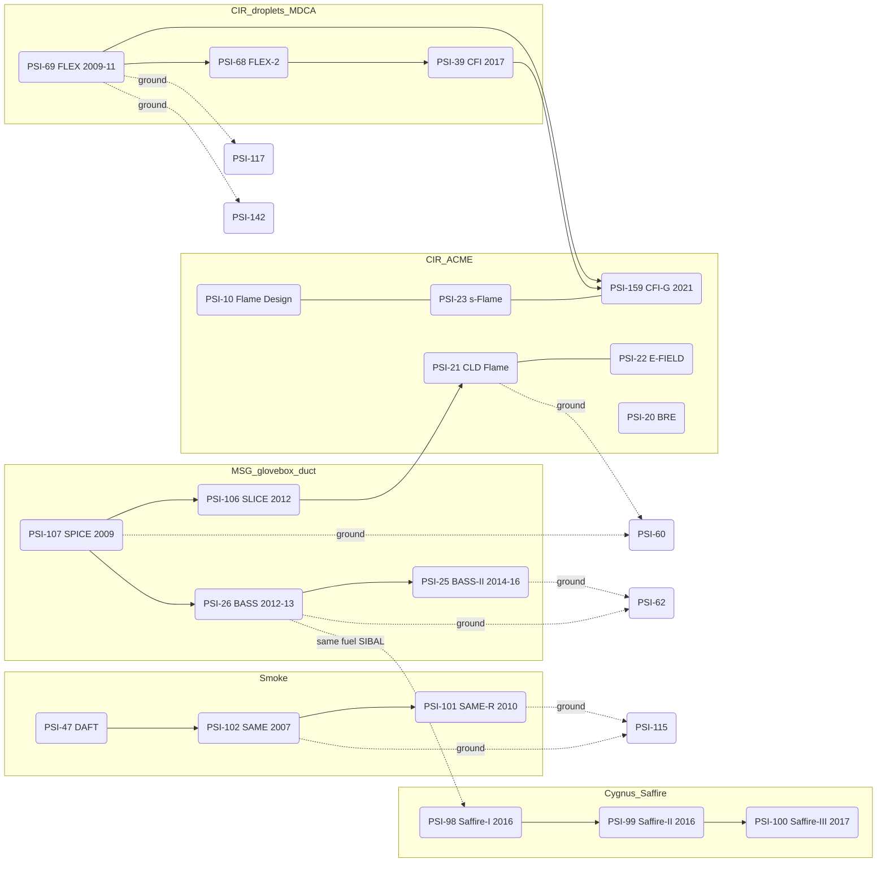

# Fire in microgravity: what the 24 PSI combustion records say together

This is a cross-cutting synthesis of the 24 verified knowledge records in `data/digest/PSI-*.json`. It is derived only from those records: no new research was done. Its machine-readable twin is `data/digest/synthesis.json`.

**Scope.** There are 19 flight investigations: BASS (PSI-26), BASS-II (PSI-25), Saffire-I/II/III (PSI-98/99/100), FLEX (PSI-69), FLEX-2 (PSI-68), CFI (PSI-39), the ACME set in the Combustion Integrated Rack (Flame Design PSI-10, BRE PSI-20, CLD Flame PSI-21, E-FIELD PSI-22, s-Flame PSI-23, CFI-G PSI-159), SLICE (PSI-106), SPICE (PSI-107), SAME (PSI-102), SAME-R (PSI-101) and DAFT (PSI-47; burns nothing). There are also five ground investigations that re-analyse flight data: PSI-60, PSI-62, PSI-115, PSI-117 and PSI-142.

**Citation convention.**

- `[PSI-26 F3]` is finding 3 (counting from 1) in that record's `findings` list.
- `[PSI-25 limitations 2]`, `[PSI-23 gaps 1]` and `[PSI-10 open_questions 2]` point to the n-th item (from 1) of those lists.
- `[PSI-159 fire_safety]`, `[PSI-107 physics]`, `[PSI-26 test_matrix]` and `[PSI-23 psi_data]` point to a whole section.

Confidence labels (high/medium/low) are the record's own `confidence` for the cited finding. Where a statement combines findings, the lowest one is given. Numbers are quoted as the records give them, including where records disagree.

**Two cautions apply throughout.**

1. Most PSI combustion work uses gas burners or droplets. These give *flame* limits, not *material flammability* limits. Only BASS, BASS-II, Saffire-I/II/III and (for smoke) SAME/SAME-R handled real solid materials.
2. In the inverse-flame tests of Flame Design and CFI-G, "85% O2" is the oxygen in the *burner stream*. The chamber held fuel and nitrogen, with no oxygen [PSI-159 fire_safety] [PSI-10 fire_safety].

---

## 1. The picture in one page

1. **Without buoyancy, a solid's flammability depends on the ventilation speed.** The boundary is U-shaped: a blow-off branch at high flow and a radiative-quenching branch at low flow. Its minimum lies at flows of about 1-10 cm/s [PSI-25 fire_safety], which only sustained microgravity reaches. For PMMA rods the fitted boundary has its minimum at about 13.5% O2, and the lowest O2 at which a flame was recorded was 13.6%, against 15.4% for upward burning in 1 g with an extra 4 cm/s of forced flow. The boundary was mapped on one rod geometry and one fabric [PSI-25 F6] [PSI-25 F8] [PSI-62 F5] [PSI-26 F5]. *(high)*
2. **Normal-gravity screening does not bound flammability in orbit for every material and configuration.** The comparisons are with downward (opposed-flow) burning in 1 g, not with the upward-burning NASA-STD-6001 Test 1 itself; for Test 1 the investigators only suggest that it may act as an ignition test [PSI-25 F7]. SIBAL cotton-fibreglass fabric cannot burn downward in 1 g, but in orbit it spread against 9-25 cm/s flows [PSI-26 F2] [PSI-98 F2] [PSI-100 F2]. Opposed spread over PMMA rods persisted to about 17-17.5% O2, against 18-19% in 1 g; two sources give different numbers [PSI-25 F9]. Near-limit ignition took up to 230 s, about ten times the Test 1 igniter time [PSI-25 F7]. *(medium)*
3. **For the fire-retarded and silicone materials flown, Test 1 was conservative at about 21-22% O2 and 15-20 cm/s, with one sample per condition.** Ultem, Nomex HT90-40 and four silicone sheets did not spread [PSI-26 F9] [PSI-99 F1] [PSI-99 F2] [PSI-99 F4]. Nomex III gave mixed results near its 1-g limit [PSI-26 F9] [PSI-25 F12]. *(medium)*
4. **Under forced ventilation, concurrent flames reach a bounded size instead of accelerating as upward fires do on Earth.** A 41 cm x 94 cm fabric sheet spread steadily at 1.8 mm/s, with a flame about 40 mm long and about 1.2 kW, at 20 cm/s. At 25 cm/s it spread at 2.3 mm/s, roughly in proportion to flow. 1-cm PMMA slabs stayed anchored at a limiting size [PSI-98 F1] [PSI-98 F3] [PSI-100 F1] [PSI-100 F3] [PSI-99 F7] [PSI-99 F11]. *(medium)*
5. **Small glovebox ducts overstate concurrent spread.** The same fabric spread faster in the 7.6 cm BASS duct at half the flow than in the large Saffire duct, which the investigators attribute to flow acceleration from hot-gas expansion [PSI-98 F6] [PSI-100 F9]. *(medium)*
6. **Quiescent microgravity flames are weak but persistent.** They survive until radiative loss cools them to about 1100-1200 K, several hundred kelvin below the about 1500 K typical of 1-g extinction. At a given supply, larger flames die sooner [PSI-10 F1] [PSI-10 F7] [PSI-117 F1] [PSI-10 F4] [PSI-20 F5] [PSI-23 F1]. *(medium)*
7. **Cutting ventilation put out small flames in air; at elevated O2 it may not.** The second half is the investigators' caution, drawn from burner flames that never had ventilation to cut [PSI-20 fire_safety]. Emulated condensed-fuel flames burned steadily for minutes in still air at 26.5-40% O2, while all flames at 21% O2 self-extinguished. Hot thermoplastics also keep emitting fuel vapour after extinction [PSI-26 F10] [PSI-98 F5] [PSI-99 F9] [PSI-100 F6] [PSI-20 F1] [PSI-20 F2] [PSI-25 F10]. *(medium)*
8. **Inert-gas suppression margins are smaller in orbit.** The droplet limiting oxygen index (LOI) in N2 was 0.12 for methanol and 0.15 for n-heptane, as much as 2-3 points below 1 g. About 30% CO2 (methanol) or 20% CO2 (heptane) was needed to stop quasi-steady burning. Helium was weaker for heptane, and modelling says xenon would be a poor agent [PSI-69 F1] [PSI-69 F2] [PSI-69 F3] [PSI-117 F8]. *(high, apart from the xenon result, which is modelled and validated on one test)*
9. **A visible flame going out does not mean the reaction has stopped.**
   - Large n-alkane droplets and gaseous n-butane flames continued as nearly invisible cool flames (about 700 K in simulations) [PSI-69 F5] [PSI-68 F1] [PSI-39 F1] [PSI-159 F1].
   - Cool flames re-ignited hot flames at 2 atm and above [PSI-39 F4] [PSI-68 F5].
   - A platinum thermocouple catalytically re-ignited a hot flame up to 5 times in one test (6 hot and 5 cool flames in sequence) [PSI-159 F5].

   *(high)*
10. **Non-buoyant flames are sootier, cooler and more radiative.** Peak soot was 4-8 times the 1-g value in coflow flames, and peak soot temperature about 200 K lower. Simulations of the BRE burner flames gave a radiative loss fraction an order of magnitude above the same burner in 1 g. Whether a small flame emits smoke depends on ventilation speed and fuel-jet size [PSI-106 F1] [PSI-21 F5] [PSI-21 F1] [PSI-20 F8] [PSI-107 F2] [PSI-107 F3]. *(medium)*
11. **Pre-fire (pyrolysis) smoke is sub-micrometre and grows with aging and stagnation.**
    - The ISS light-scattering detector stayed below the planned alarm level for most Kapton and Teflon smokes [PSI-101 F1] [PSI-101 F7] [PSI-102 F7].
    - At 8 cm/s or more, flight and ground smoke sizes matched [PSI-101 F12].
    - Single-moment detectors cannot cover this range [PSI-102 F9].

    *(high)*
12. **Exploration atmospheres are essentially untested for solid materials.**
    - Every solid-material burn ran near 1 atm and at no more than 22.7% O2 [PSI-26 test_matrix] [PSI-25 test_matrix].
    - The nearest data are gas-burner emulation of condensed fuels at 34% O2 and 56 kPa, where flames burned steadily [PSI-20 F2] [PSI-20 F4].
    - FLEX droplets at 30-34% O2 and 0.7 atm did not extinguish at all [PSI-69 F9].

    *(high that the gap exists; the burner and droplet data transfer only qualitatively)*
13. **Slow microgravity flames go out by radiative loss, not only at the diffusive (residence-time) limit known from 1 g.** FLEX methanol droplets at 1 atm extinguished diffusively at 18% O2 or more and radiatively at 14% or less; at 15-16% O2 a critical initial diameter separated the two modes, and more CO2 pushed towards radiative extinction [PSI-69 F13]. Simulations of the BRE burner flames put extinction where the instantaneous radiative fraction reaches 60-70% of the heat release, reached because the slow flame has a long residence time [PSI-20 F12] [PSI-20 F8]. Computations of the SLICE coflow flames show the mechanism: without buoyancy the peak centreline temperature is about 300 K lower and the residence time about 3.5 times longer [PSI-21 F10]. *(medium)*
14. **Cool-flame limits follow simple oxygen scalings that kinetic models miss, and pressure strengthens cool flames.**
    - FLEX-2 cool-flame extinction diameters of n-heptane, n-octane and n-decane droplets scale with the ambient O2 concentration to the power -3/4 in O2/N2; with CO2 or He and at 0.5-1 atm the residence time at extinction scales with the power -3/2 [PSI-68 F9].
    - Counterflow cool flames on the ground give an oxygen exponent of 1.7 for cool-flame reactivity, against 1.5 from the droplets, judged consistent by the authors; every kinetic model tested over-predicted n-heptane cool-flame extinction strain rates by at least a factor of two [PSI-142 F10].
    - At 0.3 MPa a decane/hexanol cool flame radiated almost half as much as the hot flame [PSI-68 F11], and above about 2 atm CFI n-dodecane cool flames often re-ignited a hot flame [PSI-39 F4].

    *(medium)*
15. **Higher pressure lowers the temperature at which flames go out radiatively and makes self-extinction more likely.** In Flame Design inverse ethylene flames the extinction temperature was similar at 0.5 and 1 atm but about 50 K lower at 3 atm, below the 1-atm critical 1130 K and into the warm-flame regime [PSI-10 F13]. In CFI-G, inverse flames fed with 85% O2 self-extinguished in 41 of 43 tests at 2.2-3.3 bar against 0 of 14 at 0.55 bar; reading this as stronger radiative loss is an inference from outcome counts [PSI-159 F8]. *(medium)*
16. **For pre-fire smoke, ventilation matters and gravity does not.** At 8.1 cm/s or more, flight and ground diameters of average mass at matched flow, temperature and aging fall on a slope-1 line, and the investigators' 2018 Fire Safety Journal paper (Meyer et al.) finds low-gravity smoke not significantly different from equivalent 1-g smoke [PSI-101 F12] [PSI-102 F6]. This supersedes the preliminary 2008 figure of about 50% larger particles in low gravity [PSI-102 F5]. At zero flow the diameter of average mass was on average about 1.7-2 times larger (1.3 for Teflon to 2.8 for Kapton), so smoke trapped in a poorly ventilated enclosure will be larger than smoke in ventilated cabin air [PSI-101 F4] [PSI-101 F3]. *(medium)*
17. **Ground tests stand in for microgravity flammability only with a correction, each checked on one material.**
    - BASS-II PMMA rods: the 1-g blowoff boundary matches the microgravity one when shifted by a buoyant stretch of about 78 1/s (about 16.5 cm/s of forced flow); proposed as a ground estimate, untested for other materials [PSI-25 F14].
    - Saffire-II thick PMMA: lowering the pressure in 1 g slowed concurrent spread towards the flight rate, but about 20 kPa would be needed to match it, where pressure also changes the chemistry [PSI-99 F10].
    - Models are not yet a substitute: the PSI-62 1-D model and thin-flame theory put the minimum O2 for PMMA rods at 11.1% (one-step chemistry) and 12.6% (detailed mechanism), 2.4 and 0.9 points below the measured minimum of about 13.5% [PSI-62 F7] [PSI-25 F6].

    *(medium)*
18. **Sooting rankings measured in 1 g do not carry over to microgravity.** Over all three SPICE burners the archival paper's smoke-point correlation ranks sooting propensity ethylene < propane < 50% < 75% propylene < propylene: overall propane soots more than ethylene in microgravity, the reverse of 1 g, which the authors attribute to propane's longer residence time at equal flame length. The 1-g order holds only at the 1.6 mm burner [PSI-107 F5]. Propane's microgravity threshold soot index (1.39) is more than twice its 1-g value (0.6), while ethylene and propylene match [PSI-107 F6]. *(medium)*

---

## 2. By fire-safety pillar

### 2.1 Prevention and material flammability

**Established (solid materials, about 1 atm, 13.6-22.7% O2).**

*Flammability boundary of PMMA rods (BASS-II).*
- PMMA rods in concurrent (stagnation) flow trace a U-shaped boundary of O2 against stretch rate, with a minimum of about 13.5% O2 at $a$ = 8-12 s$^{-1}$ (about 1.7-2.5 cm/s) [PSI-25 F6]. *(high)*
- The blow-off branch is linear in O2 and stretch, and a critical Damköhler number holds along the whole boundary [PSI-25 F6] [PSI-62 F5]. *(high)*
- The 5.18 s drop-tower blow-off points agreed with the ISS data [PSI-25 F6]. *(high)*

*Ignition is a separate, higher limit.*
- Below about 14.5% initial O2, no rod could be ignited, yet flames lit at higher O2 survived down to 13.6% [PSI-25 F7]. *(high)*
- Ignition delay below 16% O2 reached 230 s [PSI-25 F7]. *(high)*
- In BASS, 2-cm PMMA spheres at about 17% O2 needed 1.5-4 min of igniter heating [PSI-26 F12]. *(low; log notes only)*

*Thin fuels.*
- The highest opposed spread rate over 100 µm PMMA in microgravity (2.2 mm/s) matched 1-g downward spread (2.0 mm/s), which shows downward burning on Earth is thermally controlled [PSI-25 F3]. *(high)*
- Thin PMMA flames went out radiatively at about 1 cm/s in air, independent of thickness [PSI-25 F1]. *(high)*

*Thick fuels.*
- Thick PMMA slabs spread very slowly, at 0.012-0.144 mm/s, and one-sided slabs needed more flow to survive [PSI-25 F4] [PSI-25 F5]. *(high and medium)*

*SIBAL fabric.*
- Opposed spread peaks at 10-15 cm/s [PSI-26 F1]. *(high)*
- Concurrent spread grows linearly with flow [PSI-26 F3]. *(medium)*
- Concurrent flames quench below about 1 cm/s [PSI-26 F5], or at 1-5 cm/s at 16.4-20.8% O2, rising as O2 falls [PSI-25 F11]. *(high)*

*Large samples (Saffire).*
- Under forced flow, concurrent flames over thin fabric and thick PMMA reach steady or bounded size [PSI-98 F1] [PSI-99 F5] [PSI-99 F7] [PSI-99 F11] [PSI-100 F1]. *(high)*

*Materials that did not burn.*
- Nomex HT90-40 did not ignite even under a PMMA pilot flame of about 460 W [PSI-99 F4]. *(high)*
- Silicone sheets did not spread [PSI-99 F1]. *(high)*
- Ultem did not burn [PSI-26 F9]. *(medium)*

**Established (gas-burner emulation of condensed fuels, BRE).**
- A 25 mm emulated surface burned quasi-steadily for 2-5 min in quiescent 26.5-40% O2, but self-extinguished within 40 s at 21% O2 [PSI-20 F1] [PSI-20 F2]. *(high)*
- Higher fuel flux and larger burners extinguished sooner [PSI-20 F4] [PSI-20 F5]. *(medium)*

**Suggested only.**
- Real materials (PE, PP, nylon, PMMA) may burn steadily in microgravity at 1-3 g m$^{-2}$ s$^{-1}$, far below 1-g rates [PSI-20 F9]. *(low; model mapping, no material was burned)*
- Lower pressure widens the steady-burning range [PSI-20 F10]. *(low; model)*
- Silicone may be self-protected by silica deposition at low flow [PSI-99 F3]. *(low; hypothesis)*
- A BASS-II-sized fire would raise CO in the ISS US Lab by only about 1.5 ppm [PSI-25 F13]. *(high for the measurements; the extrapolation is the investigators')*
- Melting fuels can eject burning droplets upstream, shown by one wax-candle event [PSI-25 F12] [PSI-26 F14]. *(medium)*

**Contradicted or unresolved.**
- *Nomex III.* One BASS sample burned at 22% O2 and 14-15 cm/s [PSI-26 F9]. Three BASS-II samples failed to sustain flame at 21.0-22.2% O2 and 8-15 cm/s [PSI-25 F12]. BASS's sample naming is ambiguous [PSI-26 gaps 10]. Both results are reported. This looks like a material sitting at its limit, not a settled rating.
- *Opposed spread over rods.* The NASA Technical Memorandum (TM) gives a minimum O2 of 17.5% (microgravity) against 19% (1 g). The journal paper gives 17% against 18%, and says spread rate first rises then falls with flow instead of rising monotonically [PSI-25 F9] [PSI-25 gaps 5]. The direction (microgravity more flammable) agrees; the margin does not.
- *Silicone versus PMMA and cellulose.* Silicone was *less* flammable in microgravity [PSI-99 F2], while PMMA and SIBAL were *more* flammable [PSI-25 F6] [PSI-26 F2]. These do not contradict each other but show that the gravity effect depends on the material. The silicone result may also reverse at 60-80 cm/s [PSI-99 limitations 3].

### 2.2 Detection

**Established.**

*Pre-ignition smoke from five spacecraft materials (SAME, SAME-R).*
- Unaged smoke had diameters of average mass of about 0.11-0.47 µm (SAME-R) or 0.18-0.47 µm (SAME), with geometric standard deviation about 1.8-2.4 [PSI-101 F1] [PSI-102 F1]. *(high)*
- 720 s of aging coarsened and narrowed the distribution, by coagulation; Teflon was the exception (no growth, wider distribution) [PSI-101 F2] [PSI-102 F2]. *(high)*
- Lower flow past the source gave larger particles [PSI-101 F3]. *(high)*
- Silicone and lamp-wick smoke had about 40-50% of its mass above 1 µm; Kapton and Teflon had about 20% [PSI-101 F6] [PSI-102 F4]. *(high)*

*Detector response.*
- The ISS forward-scattering detector read below its planned 2 V alarm level in 21 of 30 Kapton and 12 of 17 Teflon entries, but saturated for silicone, lamp wick and Pyrell [PSI-101 F7]. *(high)*
- The Shuttle ionization detector responded to every SAME test [PSI-102 F7] (high), but in SAME-R it was less sensitive overall [PSI-101 F8]. *(medium)*
- A two-moment prototype sensor (MPASS) at least halved the response variance [PSI-101 F9]. *(medium)*

*ISS background (DAFT).*
- Undisturbed ISS air held under 15 particles/cm³ and under 0.005 mg/m³, with Velcro transients above 30,000 particles/cm³ [PSI-47 F2] [PSI-47 F3]. *(high)*
- The microgravity-modified condensation counter used by SAME worked [PSI-47 F1]. *(high)*

*Invisible flames.*
- Diluted hydrogen flames were invisible to colour cameras and were tracked only by OH* (310 nm) [PSI-23 F12]. *(medium)*
- Gaseous cool flames were found only after the fact, in intensified formaldehyde-filtered imagery and radiometer data [PSI-159 F1] [PSI-159 fire_safety]. *(high)*
- CFI's narrowband water-band radiometer responded to cool flames [PSI-39 fire_safety].

*Transport to detectors.*
- A zero-gravity FDS model of the ISS Destiny lab gives long, location-dependent detection times, and some low-soot fires never alarmed [PSI-102 F11]. *(medium)*

**Suggested only.**
- Ion current tracks flame luminosity and intensity, hinting at electrical flame sensing [PSI-22 F3]. *(medium; not tested on fires)*
- 2-D simulations of dibutyl phthalate (DBP) vapour predict a large-particle mode (about 30 µm) in microgravity wakes that settling removes in 1 g [PSI-115 F1] [PSI-115 F4]. *(high within the model; it was never compared with SAME data [PSI-115 limitations 1], and its micrometre-scale sizes are an order of magnitude above every SAME measurement)*
- The Cygnus smoke-detector telemetry recorded during the Saffire fires has not been analysed [PSI-98 open_questions 3] [PSI-100 open_questions 5].

**Contradicted.**
- *Is microgravity smoke larger?* The 2008 preliminary SAME analysis found count mean diameters about 50% larger in low gravity [PSI-102 F5] *(medium)*. The 2013 flight-versus-ground comparison found ground tests at 8 cm/s "very close" to flight [PSI-102 F6] *(medium)*. SAME-R found the ground and flight diameters on a slope-1 line [PSI-101 F12] *(high)*. **Handling:** this synthesis follows the later, matched-flow results. Microgravity smoke is larger mainly when flow is low or zero, through longer residence time, not because of gravity as such.
- *By how much at zero flow?* SAME-R gives three numbers for the zero-flow size increase: 30-40%, 2-3 times and an average of 1.7 times [PSI-101 F4] *(medium)*. The range is kept as reported.
- *Baseline sizes.* Absolute sizes differ by tens of percent between SAME analyses (for example, Kapton geometric mean diameter 80 nm in SAME against 47 nm in SAME-R) [PSI-102 limitations 2] [PSI-101 F1].

### 2.3 Suppression

**Established.**
- *Droplet inerting.* The LOI in O2/N2 at 1 atm is 0.12 for methanol and 0.15 for n-heptane. Dispersed CO2 raised it to 0.14 and 0.17, and helium to 0.14 and 0.15 [PSI-69 F1] [PSI-69 F2] [PSI-69 F3]. *(high)*
- *Diluent physics.* Helium raises the burning rate through its high conductivity, while CO2 lowers it [PSI-69 F7] [PSI-68 F3]. *(high)* Transport properties of the diluent, not only its heat capacity, set the LOI [PSI-69 F3]. *(high)*
- *Nitrogen jet on solids.* A nitrogen jet of up to about 500 sccm, aimed from upstream, usually removed only the leading edge of PMMA sphere flames, which survived as wake or side flames [PSI-26 F10]. *(medium)*
- *Ventilation shutdown.* Stopping the flow extinguished small flames in BASS, Saffire-I/II/III and BASS-II [PSI-26 F10] [PSI-26 F11] [PSI-98 F5] [PSI-99 F9] [PSI-100 F6] [PSI-25 F1]. *(medium)*
- *After extinction.* Rods keep producing fuel vapour after extinction, so suppression should continue until the material has cooled [PSI-25 F10]. *(medium)*

**Suggested only.**
- Xenon would support droplet burning down to about 5% O2 (model) [PSI-117 F8]. *(high in the record, but validated on one FLEX test)*
- Helium enlarges the cool-flame extinction diameter, leaving more unburnt liquid [PSI-39 F5] [PSI-68 F3]. *(high)*
- In inert-gas atmospheres, helium made ignition much harder and shifted burner-flame limits [PSI-23 F8] [PSI-23 F9]. *(high and medium)*
- Cool-flame-supported heptane burning may have its own LOI of about 0.10 O2 (theory) [PSI-69 F6]. *(medium)*

**Contradicted or unresolved.**
- *Helium LOI for methanol.* FLEX measured about 0.14 for helium-diluted methanol droplets [PSI-69 F3]. The PSI-117 model gives 21% for both He and CO2 at a 1.5 mm initial diameter [PSI-117 F8]. The droplet sizes and limit definitions differ, so the model value should not be read as a correction of the measurement. Both are reported.
- *Why the nitrogen jet failed.* The crew log blames entrained air, while the investigators' summary blames heat stored in the thick solid [PSI-26 F10]. Both explanations are kept.

No flight test used a real extinguisher (portable CO2, water mist) or a cabin-scale discharge [PSI-26 limitations 6] [PSI-69 limitations 1].

### 2.4 Fundamentals that underpin the others

**Established.**
- *Two extinction branches for fed flames.* Spherical burner flames show both a kinetic branch (low flow, small flame) and a radiative branch (high flow, large flame) [PSI-23 F2] [PSI-23 F4]. Radiative extinction, never seen in drop towers, was common on the ISS [PSI-23 F4]. *(medium and high)*
- *Steady spherical flames exist* if they are smaller than the radiative-extinction size. They burned for up to 870 s [PSI-10 F3]. *(high)*
- *Critical flux at extinction.* At 1 atm the critical reactant flux through the flame was 0.2 g m$^{-2}$ s$^{-1}$ of fuel (normal flames) and 0.68 g m$^{-2}$ s$^{-1}$ of O2 (inverse flames) [PSI-10 F1]. *(high)*
- *Soot structure.* Soot moves from the centreline (1 g) to the wings (microgravity) of coflow flames [PSI-106 F2] [PSI-21 F5]. *(medium)*
- *Flame length.* Length scales with fuel mass flow, and microgravity flames are 28% longer on average [PSI-106 F4]. *(high)*
- *Smoke points.* Smoke points exist without buoyancy, contrary to an earlier prediction [PSI-107 F1]. *(high)*
- *Cool-flame chemistry.*
  - Cool-flame reactivity scales with $X_{O_2}^{1.5\text{-}2}$ [PSI-142 F5]. *(high)*
  - Longer alkanes give more robust cool flames [PSI-117 F2] [PSI-142 F1]. *(high)*
  - Pressure lowers the cool-flame extinction diameter of n-dodecane steeply [PSI-39 F2] [PSI-117 F4]. *(high)*
- *Model failures.*
  - Soot models do not reproduce the eightfold microgravity soot increase [PSI-106 F3] [PSI-60 F3]. *(high and medium)*
  - Kinetic mechanisms do not reproduce cool-flame extinction [PSI-142 F4] [PSI-68 F8] [PSI-117 limitations 3]. *(high and medium)*

**Suggested only.**
- An electric field can make microgravity flames resemble 1-g flames. This was shown in a drop tower, not calibrated to partial gravity on the ISS [PSI-22 F8]. *(medium)*
- Flamelet-manifold models capture the U-shaped boundary only qualitatively [PSI-62 F4]. *(medium)*

**Contradicted.**
- *Re-ignition at 1.25 atm.* PSI-117 reports hot-cool cycling for n-dodecane at 1.25 atm [PSI-117 F4] and models four transitions for a 7 mm droplet [PSI-117 F6]. The CFI spreadsheet records no re-ignition for any n-dodecane test at 0.5-1.25 atm [PSI-39 F4]. The likely cause is model against experiment and different droplet sizes; it is unresolved.
- *Cool-flame extinction diameters at 0.75 atm.* PSI-39 gives 0.68-1.14 mm and PSI-117 0.49 mm [PSI-39 F2] [PSI-117 F4]. These are probably different test subsets; neither record maps its points to FLEX test numbers [PSI-117 gaps 4].
- *Sign of the model error.* A simplified-chemistry model over-predicts n-dodecane cool-flame extinction diameters [PSI-68 F8], while the detailed model under-predicts them by 1.5-4 times [PSI-117 limitations 3]. The sign of the error therefore depends on the mechanism.

---

## 3. By control parameter

### 3.1 Oxygen fraction

**Trends.**

*Solids.*
- Lower O2 raises the radiative-quenching flow for thin PMMA, from about 1 cm/s in air to 2.6-4 cm/s at 16% O2 [PSI-25 F2]. *(medium)*
- It raises the quenching flow of fabric [PSI-25 F11]. *(high)*
- It slows opposed spread over rods [PSI-25 F9]. *(medium)*
- It lengthens ignition delay sharply below 16% O2 [PSI-25 F7]. *(high)*

*Gas and condensed-fuel emulation.*
- Raising O2 from 21% to 26.5-40% turned self-extinguishing BRE flames into steady ones [PSI-20 F2]. *(high)*
- It raised CFI-G ignition success and burn time: 41 of 64 normal flames ignited at 21% O2 against 88 of 112 at 40%, with median burn times of 8 s and 49 s [PSI-159 F7]. *(high)*
- In s-Flame, 45% methane gave no quasi-steady flame at 21% O2 (only kinetic extinction), but at 30% O2 it burned for 10-15 s at low flow and grew to radiative extinction at higher flow [PSI-23 F3]. *(medium)*
- Normal Flame Design flames grow smaller as ambient O2 rises [PSI-10 F4]. *(high)*

*Droplets.*
- The burning-rate constant rises with O2: methanol median about 0.35 mm²/s at 0.12-0.14 O2 to 0.68 mm²/s at 0.30 O2 [PSI-69 F7]. *(high)*
- At 0.30-0.34 O2 and 0.7 atm, no FLEX droplet extinguished: they disrupted or burned out [PSI-69 F9]. *(high)*
- At 25% O2 and 0.5 atm, a 3.79 mm decane droplet avoided radiative extinction and micro-exploded [PSI-68 F2]. *(high)*

*Cool flames.*
- CFI-G cool flames appeared only at about 39-40% ambient O2 [PSI-159 F2]. *(high)*
- At 17% O2 the hot droplet flame was weak, and the cool-flame extinction diameter was larger [PSI-39 F7]. *(medium)*

| Investigation | O2 tested | Fuel phase | Note |
|---|---|---|---|
| BASS (PSI-26) | 0.159-0.227 | solid | 2013 runs vitiated with N2; the logged O2 is sometimes the pre-vitiation reading [PSI-26 limitations 4] |
| BASS-II (PSI-25) | 0.136-0.222 | solid | calibrated before/after readings; O2 fell up to 3.2 points during a burn [PSI-25 limitations 1] |
| Saffire-I/II/III (PSI-98/99/100) | 0.210-0.221 | solid | cabin air; not controlled [PSI-98 limitations 3] [PSI-99 limitations 2] |
| FLEX (PSI-69) | 0.12-0.34 | liquid droplet | 0.30 and 0.34 tested at 0.7 and 1 atm |
| FLEX-2 (PSI-68) | 0.14-0.30 (0.17-0.30 planned table) | liquid droplet | combinations actually run not in PSI [PSI-68 limitations 1] |
| CFI (PSI-39) | 0.17, 0.21 | liquid droplet | 0.35-0.40 planned, not flown [PSI-39 limitations 2] |
| Flame Design (PSI-10) | ambient 0.198-0.399; burner stream 0.21-0.85 | gas | inverse flames: O2 only in the burner stream |
| CFI-G (PSI-159) | ambient 0.18-0.40; burner stream 0.12-0.85 | gas | ambient capped at 40% by ACME |
| BRE (PSI-20) | 0.21-0.40 | gas (emulating condensed fuel) | quiescent |
| s-Flame (PSI-23) | 0.175-0.30 | gas | N2 or He atmospheres |
| CLD Flame, E-FIELD, SLICE, SPICE (PSI-21/22/106/107) | air (about 0.21; SPICE 0.19-0.24) | gas | not varied |
| SAME, SAME-R, DAFT (PSI-102/101/47) | cabin air, not recorded | solid pyrolysis / aerosol | [PSI-101 gaps 3] [PSI-102 gaps 2] |
| PSI-117 (model) | 0.04-0.21 | liquid droplet | LOI sweeps |
| PSI-142 (lab) | not recorded in the deposit | prevaporised liquid / gas | [PSI-142 limitations 1] |

**Edges of the data.**
- There is no solid-material test above 22.7% O2.
- No *ambient* O2 above 0.40 appears anywhere. FLEX's 0.34 is the highest ambient O2 for a condensed fuel.
- Below the air level, BASS-II at 13.6% and the FLEX droplet LOIs (0.12-0.15) bound the data.

### 3.2 Pressure

**Trends.**

*Droplets (CFI, PSI-117).* Pressure shortens chemical times:
- The n-dodecane cool-flame extinction diameter falls from about 1.7-1.9 mm at 0.5 atm to near zero at 2-5 atm [PSI-39 F2] [PSI-117 F4]. *(high)*
- The cool-flame burning rate rises from about 0.32 to 0.52 mm²/s between 0.5 and 5 atm [PSI-39 F3] [PSI-117 F5]. *(medium and high)*
- Above about 2 atm, cool flames re-ignite hot flames [PSI-39 F4]. *(high)*
- At about 3 atm, decane/hexanol droplets burned out with a different cool flame [PSI-68 F5]. *(high)*

*Inverse burner flames (CFI-G).* Self-extinction rose with pressure: 0 of 26 at 0.55 bar, 19 of 39 at 1.1 bar and 31 of 35 at 2.2 bar [PSI-159 F8]. *(medium; inferred from outcome counts)*

*Emulated condensed fuels (BRE).*
- Oscillation and extinction times did not depend on pressure over 0.57-1 bar [PSI-20 F5]. *(medium)*
- Qualitatively, lower pressure gave more stable flames [PSI-20 F7] *(low)*, and the model predicts a wider steady-burning range at low pressure [PSI-20 F10] *(low)*.

*Solids.* The only pressure data are ground tests in 1 g. Lowering pressure from 100 to 40 kPa slowed thick-PMMA spread toward the flight value, and matching microgravity would need about 20 kPa [PSI-99 F10]. *(medium)*

| Investigation | Pressure tested (kPa) | Fuel phase | Note |
|---|---|---|---|
| CFI (PSI-39) | 50.7-506.6 | liquid | 0.25 atm in the record text was never run [PSI-39 gaps 4] |
| FLEX (PSI-69) | 70-73, 100-103, 206-309 | liquid | high-pressure series cut short |
| FLEX-2 (PSI-68) | 50.7-304 (planned) | liquid | |
| PSI-117 (model) | 50.7-506.6 (ozone cases to 2533) | liquid | |
| Flame Design (PSI-10) | normal 94-133; inverse 43-306 | gas | round-2 pressure results unpublished in PSI [PSI-10 limitations 5] |
| CFI-G (PSI-159) | normal 50.7-304; inverse 49.5-331 | gas | inverse table pressures about 9% high [PSI-159 gaps 8] |
| BRE (PSI-20) | 56-100 | gas (emulating condensed fuel) | per-test pressures not in PSI [PSI-20 gaps 2] |
| s-Flame (PSI-23) | about 101 at fill (104-110 uncalibrated) | gas | |
| BASS, BASS-II, Saffire (PSI-26/25/98/99/100) | 96-102 | solid | cabin pressure only |
| SAME, SAME-R, SPICE, SLICE, CLD, E-FIELD | about 101 (often unstated) | solid pyrolysis / gas | |
| PSI-142 (lab / model) | 101 (DME model to 2026) | gas | |

**Edges.**
- No flight burn of a solid material ran below 96 kPa.
- No flight test ran below about 43 kPa (Saffire-II ground tests in 1 g went to 40 kPa [PSI-99 F10]), so the spacesuit condition (29.6 kPa) is untouched.
- The only reduced-pressure condensed-fuel data are droplets at 0.5-0.75 atm in air (CFI) and at 0.7 atm (FLEX).

### 3.3 Airflow speed and direction

**Trends.**

*Opposed against concurrent flow.*
- Opposed spread over thin fabric peaks at about 10-15 cm/s [PSI-26 F1]. *(high)* It was slower at 25 cm/s (0.98 mm/s) than at 20 cm/s (1.3 mm/s) [PSI-100 F4] *(low; two flights, about 10 cm of burning each)*.
- Concurrent spread rises with flow: linearly in the BASS duct [PSI-26 F3] *(medium)*, and roughly in proportion to flow between Saffire-I and III [PSI-100 F3] *(medium)*.
- At about 10 cm/s, concurrent flames spread about twice as fast as opposed ones [PSI-26 F7]. *(high)*
- The concurrent/opposed ratio grew from 1.4 at 20 cm/s to 2.3 at 25 cm/s [PSI-100 F2]. *(high)*

*Low-flow sensitivity.*
- All BASS flames were especially sensitive to flows of 0-5 cm/s [PSI-26 F15]. *(medium)*
- Below 1 cm/s, flames turned dim, blue and long-lived [PSI-26 F15] [PSI-26 F11]. *(medium)*

*Smoke.*
- Higher coflow lengthens the smoke point of gas-jet flames [PSI-107 F2]. *(high)* In 1 g, an unconfined 13.7 mm burner reverses this trend [PSI-107 F12]. *(high)*
- Lower flow past an overheated sample coarsens its smoke [PSI-101 F3]. *(high)*

| Investigation | Flow range (cm/s) | Fuel phase | Direction |
|---|---|---|---|
| BASS (PSI-26) | below 1 to about 44 | solid | opposed, concurrent, stagnation/wake |
| BASS-II (PSI-25) | below 1 to about 55 | solid | opposed, concurrent/stagnation |
| Saffire-I (PSI-98) | 20 | solid | concurrent and opposed |
| Saffire-II (PSI-99) | 20-25 | solid | concurrent (8 samples), opposed (1 sample) |
| Saffire-III (PSI-100) | about 25 (planned 30) | solid | concurrent and opposed |
| SAME-R (PSI-101) | 0-8.1 | solid pyrolysis | flow past heated sample |
| SAME (PSI-102) | 2-8 | solid pyrolysis | flow past heated sample |
| SPICE (PSI-107) | 5.4-65 at smoke points | gas | coflow |
| SLICE (PSI-106) | coflow 15-70; fuel up to 320 | gas | coflow |
| FLEX-2 (PSI-68) | 0.1-5 (droplet translation, planned) | liquid | relative flow |
| FLEX, CFI (PSI-69/39) | quiescent (residual drift 1-2 mm/s in FLEX) | liquid | none |
| Flame Design, s-Flame, BRE, CFI-G | quiescent; burner-driven flow only | gas | none |
| PSI-115 (model) | 8-10 | aerosol from vapour | channel flow |

**Edges.**
- Flows below about 1 cm/s exist only as fan-potentiometer settings, not measured speeds [PSI-25 limitations 2] [PSI-26 limitations 3].
- Large samples were tested at only two speeds (20 and 25 cm/s).
- Silicone was not tested at the 60-80 cm/s that buoyancy produces in 1 g [PSI-99 F3].

### 3.4 Fuel type, phase, geometry and scale

**Trends.**
- *Solids:* spread rate falls with thickness (thin films against thick slabs), with rod diameter and with sample width [PSI-25 F4] [PSI-25 F9] [PSI-98 F7]. *(high to medium)*
- *Emulated surfaces:* larger burners (50 mm against 25 mm) extinguished sooner [PSI-20 F5]. *(medium)*
- *Droplets:*
  - The burning rate decreases with initial diameter as soot and radiation grow [PSI-68 F6]. *(high)*
  - Large n-alkane droplets show three-stage burning [PSI-68 F6] [PSI-69 F5]. *(high)*
  - Methanol extinction is set by water it absorbs [PSI-69 F8]. *(high)*
- *Gaseous fuels:*
  - Methane BRE flames died within a minute where ethylene burned for minutes [PSI-20 F6]. *(medium)*
  - Hydrogen flames did not extinguish radiatively within the chamber's flow and size range [PSI-23 F6]. *(medium)*
  - Propane is relatively sootier in microgravity than its 1-g rank suggests [PSI-107 F6]. *(medium)*

| Investigation | Fuels | Phase | Geometry and scale |
|---|---|---|---|
| BASS (PSI-26) | SIBAL fabric, Nomex, Ultem, PMMA, wax | solid | 1-2 cm wide sheets, 1-2 cm spheres, candles |
| BASS-II (PSI-25) | PMMA films/slabs/rods, SIBAL, Nomex III, candle | solid | 0.1-5 mm thick, rods 6.35-12.7 mm, about 10 cm long |
| Saffire-I/III (PSI-98/100) | SIBAL | solid | 40.6 x 94 cm sheet |
| Saffire-II (PSI-99) | silicone, SIBAL, PMMA/Nomex, thick PMMA | solid | 5 x 29 cm strips |
| SAME/SAME-R (PSI-102/101) | Kapton, Teflon, silicone, lamp wick, Pyrell, DBP | solid pyrolysis / liquid | samples of about 3-5 mm |
| FLEX/FLEX-2/CFI (PSI-69/68/39) | methanol, alkanes C7-C12, alcohol blends, farnesane | liquid | droplets 1.1-6.4 mm |
| BRE (PSI-20) | C2H4, CH4 (emulating PMMA, PE etc.) | gas | flat burners 25 and 50 mm |
| Flame Design, s-Flame, CFI-G | C2H4, CH4, H2, C2H6, C3H8, n-C4H10 | gas | 6.35 mm porous sphere |
| CLD, E-FIELD, SLICE, SPICE | CH4, C2H4, C2H6, C3H6, C3H8 | gas | jets of 0.41-3.23 mm |

**Edges.**
- The materials are mostly PMMA and one cellulosic fabric. There are no charring composites, foams or wire insulation in flaming tests, and no cluttered geometry.
- There are only two large-scale samples, both of the same fabric [PSI-98 limitations 5].

### 3.5 Diluent and suppressant gas

**Trends.**
- *Helium:* raises droplet burning rates and enlarges cool-flame extinction diameters [PSI-69 F7] [PSI-68 F3] [PSI-39 F5]. *(high)* It makes hot-wire ignition of burner flames much harder [PSI-23 F8]. *(high)*
- *CO2:* lowers the burning rate and raises the LOI more than helium for heptane [PSI-69 F2] [PSI-69 F7]. *(high)*
- *Xenon:* gives longer burns and a much lower LOI (model) [PSI-117 F8]. *(high in the record; one validating test)*
- *Nitrogen dilution of the fuel:* raises $Z_{st}$ and suppresses soot [PSI-10 F8]. *(high)* It narrows the BRE flame and changes its radiation [PSI-20 F7]. *(low)*

| Investigation | Diluent / agent | Range |
|---|---|---|
| FLEX (PSI-69) | CO2; He | CO2 0.05-0.50 (0.70 at 2-3 atm); He 0.05-0.45 mole fraction |
| FLEX-2 (PSI-68) | N2, He, CO2, Xe | He to 75%; CO2 and Xe only in publications |
| CFI (PSI-39) | He replacing N2 | 0, 0.29, 0.59 |
| s-Flame (PSI-23) | N2 or He (fuel and atmosphere) | about 21-30% O2 in He |
| PSI-117 (model) | He, CO2, Ar, Xe | Xe up to 0.63 |
| BASS (PSI-26) | N2 jet from a 3.2 mm nozzle | 0-500 sccm |
| BASS-II (PSI-25) | N2 vitiation of the glovebox | to 13.6% O2 |

**Edges.** Agents were tested only as well-mixed diluents around droplets, or as one small nitrogen jet. There are no data on cabin-scale discharge, water mist or halocarbons.

### 3.6 Gravity level

All flight data are ISS or free-flying Cygnus microgravity, typically below $10^{-5}g_0$ in the Combustion Integrated Rack [PSI-39 test_matrix] [PSI-69 test_matrix]. Comparisons come from 1-g ground tests, from 2.2-5.18 s drop towers [PSI-10 F7] [PSI-20 F11] [PSI-25 F6] [PSI-22 F8] [PSI-68 F6], and from simulations with gravity switched on or off [PSI-115 F4] [PSI-60 F1] [PSI-117 F12].

- **There is no partial-gravity combustion data in PSI.** E-FIELD offers only an electrically imposed body force that acts along the ion-current path. It is not buoyancy, and no ISS test was calibrated to lunar or Martian gravity [PSI-22 F8] [PSI-22 limitations 1].
- Acceleration (g-jitter) records are not archived with the ACME data [PSI-23 limitations 7] [PSI-159 gaps 14] [PSI-10 limitations 4].

---

## 4. Extinction and limits: how flames go out in microgravity

### 4.1 One framework

Every extinction in PSI can be read as one of two balances failing.

**Residence time against chemistry (Damköhler number).**

$$\mathrm{Da}=\frac{\tau_{res}}{\tau_{chem}},\qquad \tau_{res}\sim\frac{\alpha_g}{U_r^{2}}\ \ \text{(spreading flame, relative flow } U_r\text{)},\qquad \tau_{res}\sim\frac{d_f^{2}}{\alpha}\ \ \text{(spherical burner or droplet flame of diameter } d_f\text{)}$$

Extinction occurs when $\mathrm{Da}$ falls below a critical value. The same physics produces "blow-off" for a solid in fast flow [PSI-25 F6] [PSI-62 F5], "kinetic extinction" for a small, low-flow spherical flame [PSI-23 F2], and "diffusive extinction" for a small droplet [PSI-69 F4]. In each case the residence time is too short. BASS-II found the transition between this branch and the radiative branch where the forced flow equals a diffusive velocity of about 2 cm/s [PSI-25 F8].

**Heat release against radiative loss (radiative loss fraction).**

$$\chi_r=\frac{\dot Q_{rad}}{\dot Q_{chem}}\sim\frac{\kappa_P\,\sigma T_f^{4}\,d_f^{3}}{\dot m_F\,\Delta h_c}$$

Radiation is volumetric, but heat release scales with the fuel supply. Without buoyancy to carry products away, $\chi_r$ grows with flame size and residence time until $T_f$ falls to a critical value. That value is about 1100-1130 K for quiescent spherical gas flames [PSI-10 F1] [PSI-10 F7], about 1100 K as the BRE steady-burning criterion against about 1600 K for buoyant flames [PSI-20 physics], and about 1200 K at the hot-to-cool transition of alkane droplets [PSI-117 F1].

Measured or modelled radiative loss fractions are large:
- below 0.6 for steady BRE flames [PSI-20 F8];
- over 60% of the surface heat budget (mostly surface radiation) at the lowest stretch for PMMA rods [PSI-25 F8];
- 0.4-0.6 proposed as the microgravity smoke-point criterion [PSI-107 physics].

**The isola.** For a flame with a fixed reactant supply $\dot m$, s-Flame's scaling $Da_f\sim\dot m^{2}\exp(-A\dot m^{2})$ gives two extinction flows: kinetic at small $\dot m$ and radiative at large $\dot m$ [PSI-23 physics]. The steady response is a closed isola, observed for nitrogen-diluted ethylene [PSI-23 F2]. The U-shaped boundary for solids in O2 against flow is the same idea in other coordinates [PSI-62 F4].

### 4.2 The modes, by investigation

- **Blow-off and kinetic extinction at high flow.**
  - The PMMA rod blow-off branch is linear; holes open at the stagnation point [PSI-25 F6] [PSI-25 F8].
  - Thin films blew off at about 17.4% O2 at high fan settings [PSI-25 F2].
  - A 1.2 cm fabric strip blew off at about 47 cm/s and 17.2% O2 [PSI-25 F11].
  - BASS reached no blow-off up to 44 cm/s in air [PSI-26 F6].
  - SPICE methane blew off on small nozzles at high coflow [PSI-107 F9].
- **Radiative quenching at low flow or large size.**
  - Thin PMMA: about 1 cm/s in air, independent of thickness [PSI-25 F1].
  - SIBAL: below 1 cm/s [PSI-26 F5], or 1-5 cm/s at lower O2 [PSI-25 F11].
  - Growing spherical gas flames [PSI-10 F2] [PSI-23 F1] [PSI-159 F6].
  - Large droplets [PSI-69 F4] [PSI-39 F1].
  - BRE flames above about 3 g m$^{-2}$ s$^{-1}$ [PSI-20 F4].
  - Pre-extinction oscillations (about 1 Hz) and flame holes are common precursors [PSI-25 F8] [PSI-69 F4] [PSI-10 F2] [PSI-159 F10]. The 1.4 Hz oscillation of the Saffire-I flame came at the start of the burn, not before extinction [PSI-98 F4].
- **Kinetic and low-flow limits of fed flames.**
  - s-Flame ethylene flames died during ramp-down before 1 cc/s [PSI-23 F2].
  - Methane was entirely kinetic-limited at 21% O2 [PSI-23 F3].
  - In helium, burner heat loss confounds this limit [PSI-23 F9].
- **Cool-flame transition.**
  - After radiative extinction of the hot flame, n-alkane droplets [PSI-69 F5] [PSI-68 F1] [PSI-39 F1] and 30% n-butane at 2 bar [PSI-159 F1] continue as cool flames.
  - The cool flame then dies at a finite droplet diameter, set by the residence time at the turning point of the negative-temperature-coefficient (NTC) branch [PSI-39 F2] [PSI-117 F2].
  - Between the two lies a "warm" flame at about 950 K [PSI-117 F7] [PSI-142 F6] [PSI-39 F10].
- **Oxygen limits.**
  - Droplet LOIs [PSI-69 F1] [PSI-69 F2] [PSI-69 F3].
  - The rod minimum of 13.5% [PSI-25 F6].
  - The BRE threshold of about 21-25% O2 for 25 mm flames [PSI-20 F2].
  - The lowest O2 logged in BASS, a Japan-wax candle burning at 15.9% [PSI-26 F14].
- **Other modes.**
  - Water absorption into methanol droplets [PSI-69 F8].
  - Heat loss to the burner or holder [PSI-10 F5] [PSI-25 F5] [PSI-23 F9].
  - Fuel-dilution limits of coflow flames [PSI-21 F2].
  - Fuel burnout [PSI-98 F9].
  - Ventilation shutdown, an imposed zero-flow limit [PSI-99 F9].

### 4.3 Comparison of limit values

| Investigation | Fuel | Limit type | Value | Conditions | Conf. |
|---|---|---|---|---|---|
| BASS-II (PSI-25 F1) | PMMA film, 100-400 µm | radiative quench flow | about 1 cm/s (1.5 cm/s at 400 µm) | about 21% O2, 1 atm, opposed | high |
| BASS-II (PSI-25 F2) | PMMA film | radiative quench flow | 2.6-4 cm/s | about 16% O2; 2 tests | medium |
| BASS-II (PSI-25 F6) | PMMA rod, concurrent | minimum O2 | about 13.5% | $a$ = 8-12 s$^{-1}$, 1 atm | high |
| BASS-II (PSI-25 F7) | PMMA rod | ignition limit | about 14.5% O2 | lit flames survived to 13.6% | high |
| BASS-II (PSI-25 F9) | black PMMA rod, opposed | minimum O2 for spread | 17.5% (TM) / 17% (paper) | against 19% / 18% in 1 g | medium |
| BASS-II (PSI-25 F11) | SIBAL, concurrent | quench flow | 1-5 cm/s | 16.4-20.8% O2 | high |
| BASS-II (PSI-25 F5) | PMMA slab 3-5 mm, one-sided | quench flow | 13-18 cm/s | about 20-22% O2 | medium |
| BASS (PSI-26 F5) | SIBAL, concurrent | quench flow | below 1 cm/s | about 21% O2 | high |
| BASS (PSI-26 F14) | Japan-wax candle | quench (fan setting) | potentiometer 0.31, below 1 cm/s | 21.2% O2 | medium |
| Saffire-II (PSI-99 F1) | silicone 0.27-1.03 mm | no spread | burn length about 0 | 22.1% O2, 20 cm/s | high |
| FLEX (PSI-69 F1) | methanol / n-heptane droplet | LOI | 0.12 / 0.15 | N2, 1 atm | high |
| FLEX (PSI-69 F2) | methanol / n-heptane | LOI with CO2 | 0.14 / 0.17 | about 30% / 20% CO2, 1 atm | high |
| FLEX (PSI-69 F3) | methanol / n-heptane | LOI with He | 0.14 / 0.15 | 1 atm | high |
| PSI-117 (F8) | methanol droplet, model | LOI with Xe | about 5% (4-6% for 1-2 mm) | 1 atm | high (model) |
| Flame Design (PSI-10 F1) | ethylene sphere | radiative extinction temperature / flux | 1130 K; 0.2 g m$^{-2}$ s$^{-1}$ fuel, 0.68 O2 | about 1 atm | high |
| BRE (PSI-20 F2) | C2H4/N2, 25 mm | O2 self-extinction threshold | between 21% and 26.5% (about 25%) | quiescent, 56-100 kPa | high |
| BRE (PSI-20 F4) | C2H4, 25 mm | fuel flux for self-extinction | above about 3 g m$^{-2}$ s$^{-1}$ | 34% O2, 56 kPa | medium |
| s-Flame (PSI-23 F2) | 20-30% C2H4/N2 | kinetic / radiative ext. flow | below 3 to 1 cc/s / below 8 cc/s | air, about 1 atm | medium |
| CFI (PSI-39 F1) | n-dodecane, about 4 mm | hot-flame radiative ext. | at D = 2.9-4.3 mm after 10-14 s | air, 0.5-1.25 atm | high |
| CFI (PSI-39 F2) | n-dodecane | cool-flame ext. diameter | 1.73-1.92 mm (0.5 atm) to 0-0.39 mm (1.25 atm) | air | high |
| PSI-117 (F1) | C7-C12 droplets | hot-to-cool transition temperature | about 1200 K | 1 atm air | high |
| PSI-142 (F3) | C7-C14 counterflow | hot-flame ext. fuel mass fraction | 0.041-0.055 | $a$ = 45-123 s$^{-1}$, 1 atm | high |
| PSI-142 (F1) | C7 / C14, no ozone | cool-flame ext. fuel mass fraction | 0.555 / 0.322 | $a$ about 80 s$^{-1}$ | high |
| CFI-G (PSI-159 F2) | 30% n-C4H10 | cool-flame existence window | 0.385-0.399 O2, 2.03 bar, 0.75-1.5 mg/s, burner above 515 K | normal flames | high |
| CFI-G (PSI-159 F7) | C2H6, C3H8, n-C4H10 | weak-flame regime | all flames self-extinguished within 20 s | about 21% ambient O2, 0.5-3 atm | high |

---

## 5. Microgravity versus 1 g

| Material / fuel | Quantity | Microgravity | 1 g | Direction for microgravity | Source |
|---|---|---|---|---|---|
| PMMA rod, concurrent | minimum O2 | about 13.5% | 15.4% (upward, plus 4 cm/s forced) | more hazardous | [PSI-25 F6] |
| black PMMA rod, opposed | minimum O2 for spread | 17.5% (TM) / 17% (paper) | 19% / 18% | more hazardous; spread also faster | [PSI-25 F9] |
| PMMA rod, near limit | ignition delay | up to 230 s | Test 1 igniter about 25 s | screening may act as an ignition test | [PSI-25 F7] |
| PMMA film 100 µm, opposed | maximum spread rate | 2.2 mm/s | 2.0 mm/s (downward) | about equal | [PSI-25 F3] |
| SIBAL fabric, opposed | sustained spread | yes, at 9-10 cm/s (BASS); 1.3 and 0.98 mm/s (Saffire-I, III) | does not burn downward | more hazardous | [PSI-26 F2] [PSI-98 F2] [PSI-100 F2] |
| SIBAL fabric, concurrent | growth | steady 1.8-2.6 mm/s, limiting length | accelerating, longer, sootier | less hazardous (bounded) | [PSI-26 F8] [PSI-98 F1] [PSI-99 F5] |
| silicone 0.27-1.03 mm | burn length | about 0 | complete (0.27 mm), 7.6 cm (0.61 mm), 0 (1.03 mm); 0.37 mm downward complete | less hazardous at 20 cm/s | [PSI-99 F2] |
| Nomex HT90-40 | ignition / spread | none, even under a pilot flame | about 0 burn length (burns only at about 24-25% O2) | same | [PSI-99 F4] [PSI-26 F9] |
| Ultem 1000 | burning | none at 21-22% O2 | none (ULOI 23.5%) | same | [PSI-26 F9] |
| Nomex III | burning at 22% O2 | burned (BASS) / failed (BASS-II) | ULOI 22% | unresolved | [PSI-26 F9] [PSI-25 F12] |
| PMMA slab 10 mm | concurrent spread | anchored, limiting size; slower | complete, accelerating | less hazardous (growth) | [PSI-99 F7] [PSI-99 F10] |
| PMMA rod | flame oscillation persistence | longer | shorter | more persistent | [PSI-25 F10] |
| methanol / n-heptane droplet | LOI | 0.12 / 0.15 | as much as 2-3 points higher | more hazardous | [PSI-69 F1] |
| ethylene spherical flame | extinction temperature | about 1100-1130 K | about 1500 ± 50 K (typical hydrocarbon) | more persistent | [PSI-10 F1] [PSI-10 F7] |
| ethylene BRE burner flame | radiative loss fraction | about 10 times the 1-g value (simulation) | baseline | more radiative | [PSI-20 F8] |
| emulated PMMA (model) | steady burning rate | about 2.5 g m$^{-2}$ s$^{-1}$ | about 19 g m$^{-2}$ s$^{-1}$ | burns more easily but more slowly | [PSI-20 F9] |
| ethylene coflow flame | soot volume fraction | 5-8 times | 1 | sootier | [PSI-21 F1] |
| CH4 coflow flame (SLICE) | peak soot / peak soot temperature | about 8 times / about 200 K lower | 1 / reference | sootier, cooler | [PSI-106 F1] [PSI-21 F5] |
| N2-diluted CH4 coflow | flame length | 28% longer on average | reference | larger flames | [PSI-106 F4] |
| CH4, C2H4 coflow | fuel-dilution limit | extended (lower fuel fraction) | reference | more hazardous for leaks | [PSI-21 F2] |
| propane jet | threshold soot index | 1.39 | 0.6 | sootier | [PSI-107 F6] |
| ethylene coflow (simulation) | soot, length, temperature | more soot, longer, cooler; much weaker for the small ACME flame | reference | sootier (size-dependent) | [PSI-60 F1] [PSI-60 F2] |
| Kapton, lamp wick, silicone smoke | count mean diameter | +53-65% (2008 analysis) | reference | larger particles (contested) | [PSI-102 F5] |
| pyrolysis smoke at 8.1 cm/s or more | diameter of average mass | same as ground (slope 1) | same | no gravity effect at this flow | [PSI-101 F12] [PSI-102 F6] |
| DBP smoke (2-D simulation) | size distribution | bimodal, modes about 5 and 30 µm, up to 100 µm | single mode about 5 µm, none above 40 µm | larger particles (model) | [PSI-115 F1] |
| Arizona Road Dust in a bag | mass per particle | 3.2 times | 1 | larger suspended particles (no settling) | [PSI-47 F5] |
| fuel jets (SPICE prototype in 1 g) | lift-off and smoke point | attached; shorter smoke points | lift more easily; smoke at longer lengths | sootier in microgravity | [PSI-107 F12] |
| methane coflow, E-field | ion current against voltage | distinct peak at saturation | plateau or rise | not a hazard metric | [PSI-22 F2] |

### What this means for NASA-STD-6001-style ground screening

1. **Test 1 (upward, 1 g) is non-conservative where the low-flow minimum of the U-curve matters.**
   - It applies to PMMA in concurrent and opposed flow [PSI-25 F6] [PSI-25 F9] and to thin cellulosic fabric in opposed flow [PSI-26 F2] [PSI-98 F2].
   - The dangerous flows, about 1-10 cm/s, are typical of near-surface spacecraft ventilation [PSI-25 fire_safety].
2. **Test 1 was conservative for the fire-retarded and silicone materials flown,** but only at about 22% O2 and 15-20 cm/s, with one sample per condition [PSI-99 F2] [PSI-99 F4] [PSI-26 F9] [PSI-99 limitations 1].
3. **Test 1 may screen ignitability rather than flammability near the limit,** because microgravity ignition took up to about 10 times its igniter time [PSI-25 F7].
4. **Test 1's acceleration criterion does not describe orbital fires.** Microgravity concurrent fires grow to a bounded size [PSI-99 F11], so a heat-release-based design fire is feasible [PSI-98 F3].
5. **Several ground surrogates are proposed in the records:**
   - extrapolate the linear 1-g blow-off boundary to zero stretch as a conservative minimum O2 [PSI-25 F6];
   - use the de Ris thermal-regime correlation validated in microgravity [PSI-25 F3];
   - burn at reduced pressure in 1 g to weaken buoyancy, although matching microgravity needs about 20 kPa, where chemistry changes [PSI-99 F10];
   - map cone-calorimeter (Test 2) heat of gasification onto BRE flammability maps [PSI-20 F9] *(low)*.

   None of these has been checked against a material burned at exploration conditions.

---

## 6. Exploration atmospheres (30% O2 or more at 70.3 kPa or less)

**What was tested closest to the `moon-habitat` reference (`docs/digest/reference.md`):**

| Investigation | Closest condition | Fuel phase | O2 location | Outcome |
|---|---|---|---|---|
| BRE (PSI-20) | 34% O2 at 56.5 kPa; 26.5% at 70.3 kPa | gas burner emulating a condensed fuel | ambient | steady burning for minutes in quiescent gas; 21% / 101 kPa flames self-extinguished [PSI-20 F2] [PSI-20 F4] [PSI-20 fire_safety] |
| FLEX (PSI-69) | 30% and 34% O2 at 0.7 atm (70-73 kPa) | liquid droplets (methanol, heptane) | ambient | no droplet extinguished: 15 of 17 disrupted, 2 burned out [PSI-69 F9] [PSI-69 fire_safety] |
| CFI-G (PSI-159) | about 40% O2 at 0.5 atm (about 51 kPa), normal flames | gas burner | ambient | 40% O2 raised ignition success and burn time; cool flames only at 2 bar [PSI-159 F7] [PSI-159 F2] [PSI-159 fire_safety] |
| CFI-G / Flame Design inverse flames | 85% O2 at 0.43-0.55 atm | gas burner | **burner stream only**; chamber held fuel + N2 | lower pressure, fewer self-extinctions [PSI-159 F8] [PSI-10 fire_safety] |
| s-Flame (PSI-23) | about 30% O2 at about 1 atm | gas burner | ambient | methane flames burned 10-15 s and reached both extinction branches, where none was quasi-steady at 21% [PSI-23 F3] [PSI-23 fire_safety] |
| Flame Design (PSI-10) | 30% and 40% O2 at about 1-1.3 atm | gas burner | ambient | soot only at 40% O2 with concentrated fuel [PSI-10 F6] |
| CFI / PSI-117 | 21% O2 at 0.5-0.75 atm | liquid droplets | ambient | larger cool-flame extinction diameter at low pressure [PSI-39 F2] [PSI-117 F4] |
| FLEX-2 (PSI-68) | envelope includes 0.30 O2 and 0.5-1 atm | liquid droplets | ambient | which combinations were run is not in PSI [PSI-68 fire_safety] |

**What can be concluded.**

1. Oxygen enrichment to about 26.5-40% consistently made small fed flames *more persistent*, including at reduced pressure where that was tested (BRE at 56 kPa, FLEX at about 70 kPa, CFI-G at about 51 kPa) [PSI-20 F2] [PSI-159 F7] [PSI-23 F3] [PSI-69 F9]. All four lines of evidence point the same way, though none involves a solid material.
2. Turning off ventilation in an enriched atmosphere may not quickly extinguish a small condensed-fuel fire [PSI-20 fire_safety]. This rests on gas-burner emulation; the high-confidence part is the burner result [PSI-20 F2].
3. Reduced pressure *by itself*, at 21% O2, shortens droplet cool-flame burning [PSI-39 F2]. The effect of 30% O2 on cool flames was never measured [PSI-39 fire_safety] [PSI-117 fire_safety].

**What cannot be concluded.**

- *No solid-material limit, spread rate or ignition time at elevated O2 or reduced pressure exists in PSI.* The highest O2 for any solid burn is 22.7% at about 1 atm [PSI-26 fire_safety] [PSI-25 fire_safety] [PSI-98 fire_safety] [PSI-99 fire_safety] [PSI-100 fire_safety]. For example, Nomex HT90-40's 1-g threshold of about 24-25% O2 would be exceeded in a 30% habitat, so the Saffire-II "Nomex is safe" result does not carry over [PSI-99 fire_safety].
- BRE thresholds are for burners with an imposed fuel flow. They involve no pyrolysis, melting, charring or flame spread [PSI-20 limitations 1].
- The 85% O2 inverse-flame results describe an oxygen jet into a fuel-rich region, not a cabin atmosphere [PSI-159 fire_safety].
- Droplet results are for mm-size isolated droplets in a quiescent gas [PSI-69 limitations 1].
- No smoke or detector data exist at reduced pressure or enriched O2 [PSI-101 fire_safety] [PSI-102 fire_safety] [PSI-47 fire_safety].
- The spacesuit condition (100% O2 at 29.6 kPa) was approached by no investigation [PSI-159 fire_safety] [PSI-69 fire_safety].

---

## 7. Scale and transferability

- **Small duct against large sheet (BASS against Saffire).**
  - Over SIBAL fabric, BASS 2-cm strips in the 7.6 cm duct spread at 2.55 mm/s at only about 10 cm/s [PSI-26 F7]. The 41-cm Saffire sheet spread at 1.8 mm/s at 20 cm/s and 2.3 mm/s at 25 cm/s [PSI-98 F6] [PSI-100 F9].
  - The wide sheet spread 12-14% slower than narrow 5-cm Saffire-II strips at both flows (1.8 against 2.1 mm/s, 2.3 against 2.6 mm/s) [PSI-98 F7] [PSI-100 F9].
  - The investigators attribute the duct effect to flow acceleration by hot-gas expansion [PSI-98 F6]. *(medium)*
  - The BASS linear fit has an intercept [PSI-26 F3], while the Saffire pair suggests spread proportional to flow [PSI-100 F3]. Two large-sample points cannot distinguish the two forms [PSI-100 physics].
  - Heat release scales with width: about 200 W for a 5 cm strip against about 1.2 kW for the 41 cm sheet [PSI-99 F6] [PSI-98 F3].
  - **Implication:** glovebox spread rates are upper bounds for open-cabin concurrent spread, and limits measured in small ducts include holder and wall heat losses [PSI-25 limitations 4] [PSI-26 limitations 6].
- **Emulators against materials (BRE).**
  - The emulator reproduces heat of combustion, heat of gasification and smoke point, but not pyrolysis chemistry, charring, melting or flame spread [PSI-20 limitations 1].
  - Its material predictions are model inferences [PSI-20 F9], and sizes are only 25 and 50 mm, with larger flames dying sooner [PSI-20 limitations 2].
- **Droplets against pools or sprays.** Droplet LOIs and cool-flame regimes are for isolated mm-size droplets [PSI-69 limitations 1] [PSI-39 limitations 5]. Binary arrays already change behaviour: paired droplets showed cool flames where isolated ones did not [PSI-68 F7].
- **Flame size.**
  - Gravity effects on soot weaken as the flame shrinks: they were "significantly diminished" for the small ACME coflow flame [PSI-60 F2] [PSI-21 F3].
  - Larger spherical and BRE flames die sooner by radiation [PSI-10 F4] [PSI-20 F5]. Any microgravity correction factor is therefore size-dependent.
- **Ground models against flight data.**
  - *Fair qualitative agreement:* flame shape and soot location [PSI-106 F3], flame length (within 15%) [PSI-106 F4], spread rates and the U-curve [PSI-62 F1] [PSI-62 F4], two-stage droplet burning [PSI-69 F12] [PSI-117 F1], and coagulation (within 20% in number) [PSI-101 F2].
  - *Quantitative failures:* the soot increase [PSI-106 F3] [PSI-60 F3], cool-flame extinction [PSI-142 F4] [PSI-117 limitations 3], flame size without adjusted diffusivity [PSI-10 F9], spread over thick PMMA, which a 2-D FDS simulation over-predicted [PSI-25 F4], and the leading edge in flamelet models [PSI-62 F3].
  - PSI-115's smoke model was never compared with SAME data [PSI-115 limitations 1].

---

## 8. Gaps, ranked

1. **Solid materials at elevated O2 and reduced pressure.**
   - *Why it matters:* lunar and Martian habitats and rovers are planned at 30% O2 or more and 70.3 kPa or less, and PSI has no solid-material flight data there.
   - *What partly fills it:* BRE emulation maps [PSI-20 F9] [PSI-20 F10]; FLEX droplets at 0.7 atm and 30-34% O2 [PSI-69 F9]; Saffire-II 1-g reduced-pressure correlations [PSI-99 F10]; CFI-G gas flames at 40% O2 and 0.5 atm [PSI-159 F7]; and running the PSI-62 spread model at habitat conditions [PSI-62 open_questions 3].
2. **Partial gravity (Moon 0.16 g, Mars 0.38 g).**
   - *Why it matters:* weak buoyant flows of a few cm/s may sit near the minimum of the U-curve, the most flammable region [PSI-25 F6]. There is no partial-gravity data in PSI.
   - *What partly fills it:* the E-FIELD ion-wind analogue, if its current records were obtained [PSI-22 open_questions 1]; the mixed-convection velocity correlation, which includes $g$ explicitly [PSI-99 F10]; zero-stretch extrapolation of 1-g blow-off [PSI-25 F6]; and gravity-switch simulations [PSI-115 F4].
3. **Unreduced imagery and raw signals; no per-test outcomes.**
   - *Why it matters:* terabytes of images and 125 Hz voltages hold burn times, flame radii and extinction modes that no table records [PSI-10 gaps 1] [PSI-23 limitations 1] [PSI-25 gaps 1] [PSI-26 gaps 2].
   - *What partly fills it:* the ACME interface document ACME-DOC-010 Rev D, which PSI-23's Reference Data holds and PSI-159 lacks, could convert PSI-10 and PSI-159 voltages [PSI-23 psi_data] [PSI-159 open_questions 6]. The BASS-II per-test O2 table and daily fan calibrations [PSI-25 open_questions 1] and the CFI analysed spreadsheet [PSI-39 psi_data] also help.
4. **Results held outside PSI or unpublished.**
   - BRE, CLD Flame, E-FIELD, FLEX-2, SLICE and Saffire-II have only a summary table in PSI [PSI-20 gaps 1] [PSI-21 gaps 1] [PSI-22 gaps 1] [PSI-68 gaps 1] [PSI-106 gaps 1] [PSI-99 gaps 1].
   - s-Flame has no ISS-results paper [PSI-23 gaps 1].
   - Flame Design's reduced and elevated pressure round is unanalysed in PSI [PSI-10 gaps 2].
   - The main CFI paper is closed-access [PSI-39 gaps 9].
   - *Why it matters:* many findings rest on theses and slides, not papers [PSI-20 gaps 14].
5. **Pressure effects on solid spread and limits.**
   - *Why it matters:* lower pressure changes residence time, radiative loss and buoyancy-equivalent flow.
   - *What partly fills it:* PSI-99 F10 (1-g ground data), BRE pressure trends [PSI-20 F5] [PSI-20 F7], and the CFI-G inverse-flame pressure effect [PSI-159 F8].
6. **Suppression with realistic agents and geometry.**
   - *Why it matters:* only a fixed upstream nitrogen jet and well-mixed diluents were tested [PSI-26 limitations 6] [PSI-69 limitations 2].
   - *What partly fills it:* the BASS nitrogen-outcome matrix [PSI-26 open_questions 4] and re-deriving FLEX LOIs [PSI-69 open_questions 1].
7. **Detection of flaming fires in a real vehicle.**
   - *Why it matters:* SAME covered only pre-ignition pyrolysis [PSI-101 limitations 6].
   - *What partly fills it:* the Cygnus smoke-detector, CO2 and pressure telemetry from Saffire-I and III [PSI-98 open_questions 3] [PSI-100 open_questions 5], and the SAME-R time series for time-to-alarm [PSI-101 open_questions 3].
8. **Material breadth and complex geometry.**
   - *Why it matters:* the data are mostly PMMA and SIBAL, with few repeats [PSI-26 limitations 1] [PSI-25 limitations 3] [PSI-98 limitations 1].
   - *What partly fills it:* BRE emulation, the Saffire-II thick PMMA [PSI-99 F7], and BASS-II slabs [PSI-25 F4].
9. **Flow below 1 cm/s is poorly quantified.**
   - *Why it matters:* the quenching branch lies there [PSI-25 limitations 2] [PSI-26 limitations 3].
   - *What partly fills it:* fan calibrations in PSI-25 Reference Data [PSI-25 open_questions 1] [PSI-26 open_questions 2].
10. **Cool flames at habitat conditions and for realistic fuels.**
    - *What partly fills it:* the FLEX 0.7 atm runs, model runs at 30-34% O2 and 57-70 kPa [PSI-117 open_questions 3], and a map of the cool-flame re-ignition boundary [PSI-68 open_questions 4].
11. **Combustion products and toxicity.**
    - *Why it matters:* there is one CO dataset (BASS-II), and the CO sensor saturated [PSI-25 F13].
    - *What partly fills it:* the per-test CO table [PSI-25 open_questions 6] and Saffire CO2 records [PSI-98 F8] [PSI-100 F8].
12. **Atmosphere drift and acceleration records.**
    - *Why it matters:* closed chambers vitiate during a day, and composition is computed rather than measured [PSI-23 limitations 4] [PSI-159 limitations 3] [PSI-10 limitations 4].
    - *What partly fills it:* the 170 unreduced s-Flame gas chromatograms [PSI-23 open_questions 5] and the Flame Design repeat points [PSI-10 open_questions 4].
13. **Validated soot and cool-flame models.**
    - *What partly fills it:* the SPICE soot fields [PSI-60 open_questions 1], CFI extinction data [PSI-117 open_questions 2], and Princeton extinction curves [PSI-142 open_questions 1].

---

## 9. How the investigations connect

| From | To | Relation | Evidence |
|---|---|---|---|
| SPICE (PSI-107) | SLICE (PSI-106) | shared hardware (flow duct) | [PSI-107 related] [PSI-106 related] |
| SPICE (PSI-107) | BASS (PSI-26) | shared hardware (duct modified) | [PSI-26 related] |
| SPICE (PSI-107) | BASS-II (PSI-25) | shared hardware | [PSI-25 related] |
| BASS (PSI-26) | BASS-II (PSI-25) | precursor → follow-on (same duct, new samples, N2 vitiation) | [PSI-25 related] |
| SLICE (PSI-106) | CLD Flame (PSI-21) | precursor (refined test matrix) | [PSI-21 related] |
| SPICE (PSI-107) | PSI-60 | ground re-analysis (raw camera images) | [PSI-60 related] |
| CLD Flame (PSI-21) | PSI-60 | ground re-analysis (ACME burner) | [PSI-60 related] [PSI-60 gaps 2] |
| BASS (PSI-26), BASS-II (PSI-25) | PSI-62 | ground re-analysis (flamelet models) | [PSI-62 related] |
| BASS (PSI-26) | Saffire-I/II/III (PSI-98/99/100) | same fuel (SIBAL) | [PSI-98 related] [PSI-99 related] |
| Saffire-I (PSI-98) | Saffire-II (PSI-99) → Saffire-III (PSI-100) | shared hardware, successive flights | [PSI-100 related] [PSI-99 related] |
| FLEX (PSI-69) | FLEX-2 (PSI-68) | follow-on (same apparatus) | [PSI-69 related] |
| FLEX-2 (PSI-68) | CFI (PSI-39) | follow-on (cool flames) | [PSI-68 related] [PSI-39 related] |
| FLEX / CFI | CFI-G (PSI-159) | precursor (cool flames, now gases on ACME hardware) | [PSI-159 related] |
| FLEX (PSI-69) | PSI-117 | ground re-analysis (1-D droplet model) | [PSI-117 related] |
| FLEX (PSI-69) | PSI-142 | ground re-analysis (counterflow cool flames) | [PSI-142 related] |
| ACME insert | PSI-10, 20, 21, 22, 23, 159 | shared hardware (CIR chamber) | [PSI-10 related] |
| Flame Design (PSI-10) | s-Flame (PSI-23), CFI-G (PSI-159) | shared hardware (porous sphere s/n 1003) | [PSI-23 method] [PSI-10 related] |
| CLD Flame (PSI-21) | E-FIELD (PSI-22) | shared hardware (coflow burner) | [PSI-22 related] |
| DAFT (PSI-47) | SAME (PSI-102) → SAME-R (PSI-101) | precursor (validated counter) → reflight | [PSI-47 F9] [PSI-101 related] |
| SAME, SAME-R | PSI-115 | ground re-analysis (smoke simulation) | [PSI-115 related] |

**Lineage notes.**
- The leftover BASS candle was burned in BASS-II [PSI-25 F12] [PSI-26 F14].
- BASS already vitiated the glovebox with N2 in 2013, although the BASS-II report claims the first use [PSI-26 gaps 16].
- Most published "CLD Flame" results are actually SLICE results [PSI-21 limitations 1].
- FLEX and FLEX-2 results are blurred in the literature [PSI-68 gaps 2].
- PSI-117 also models the n-dodecane droplet tests at 0.5-5 atm, which carry FLEX-numbered identifiers from the CFI campaign [PSI-117 psi_data] [PSI-39 gaps 12]. It is a compilation of the group's FLEX modelling across several grants [PSI-117 limitations 5].

---

## 10. Data-quality ledger

Counts are of records that report each problem in their `gaps` or `limitations`. **No credential, password, account name or personal contact is reproduced here.**

| Problem type | Records (count) | Examples |
|---|---|---|
| Record dates wrong, missing or grant-period only | 13: PSI-21, 22, 23, 39, 68, 69, 98, 99, 100, 106, 107, 117, 159 | CFI record says 2020-2021, tests were 2017 [PSI-39 gaps 1]; Saffire-I record says 2001-2008 [PSI-98 gaps 5]; s-Flame end date precedes the last test [PSI-23 gaps 7]; no dates at all for SLICE, SPICE, CFI-G [PSI-106 gaps 2] [PSI-107 gaps 9] [PSI-159 gaps 1] |
| Date typos inside tables or files | 6: PSI-25, 26, 39, 47, 98, 100 | 6/24/2018 for a 2014 run, and camera clocks one day ahead [PSI-25 gaps 7]; '5/15/2103' [PSI-26 gaps 9]; a 2011 farnesane date [PSI-39 gaps 2]; GMT day mismatches [PSI-47 gaps 2] [PSI-100 gaps 5]; a slide giving the wrong unberthing date [PSI-98 gaps 8] |
| Metadata zip named after another accession | 15: PSI-20, 21, 23, 25, 26, 47, 98, 99, 100, 102, 106, 107, 115, 117, 142 | BASS zip named PSI-102, which is SAME [PSI-26 gaps 7]; s-Flame zip named PSI-99, which is Saffire-II [PSI-23 gaps 6]; 'NEWID-13' [PSI-117 gaps 9] |
| Record `totalFileSize` far above the files listed | 7: PSI-20, 21, 22, 68, 69, 99, 106 | about 2 TB declared against about 16 kB present [PSI-20 gaps 10]; 72.9 GB against 9.5 kB [PSI-106 gaps 7] |
| Spreadsheet artefacts and typos in experimental tables | 16: PSI-20, 21, 22, 23, 25, 26, 39, 47, 69, 98, 99, 100, 101, 107, 117, 159 | '3400%' [PSI-20 gaps 8]; auto-filled 'CH5…CH14' [PSI-21 gaps 6]; 'N3/N4' [PSI-23 gaps 5]; offset values as O2 [PSI-25 gaps 6]; duplicate rows [PSI-22 gaps 8] [PSI-39 gaps 3]; -5.92 cm/s from a blank cell [PSI-107 gaps 2]; '#DIV/0!' [PSI-159 gaps 9]; 0.37 'cm' for 0.37 mm and length/width swapped [PSI-98 gaps 6] |
| Table does not describe what was flown | 5: PSI-47, 68, 100, 102, 107 | planning matrix instead of the flown tests [PSI-102 gaps 1]; sessions mislabelled and the dust day omitted [PSI-47 gaps 1]; 30 cm/s listed, 25 flown [PSI-100 F5]; one envelope repeated for 8 fuels [PSI-68 limitations 1]; the whole methane session missing [PSI-107 gaps 3] |
| Numbers differing between NASA documents | 18: PSI-10, 20, 21, 22, 25, 26, 39, 47, 69, 98, 99, 100, 101, 102, 107, 115, 117, 159 | rod minimum O2 17.5/19 against 17/18 [PSI-25 gaps 5]; zero-flow smoke growth 30-40% / 2-3x / 1.7x [PSI-101 gaps 5]; aged silicone 'over 1 µm' against 606 nm in the same report [PSI-102 limitations 3]; sphere regression 3.05 against 0.3 mm/min [PSI-26 gaps 15]; 52 against 55 smoke points [PSI-107 limitations 5]; 194 against 149 flames [PSI-20 gaps 6]; 280 against 271 hot flames [PSI-159 gaps 10]; 0.40 against 0.34 O2 [PSI-69 gaps 5]; duct size [PSI-107 limitations 5]; burner diameter 2.1 against 2.2 mm [PSI-21 gaps 10] |
| Sensor offsets and uncalibrated instruments | 6: PSI-23, 25, 98, 100, 101, 159 | Saffire O2 sensor about 1 point off, and pressure sensors 2.4-3 kPa apart [PSI-98 limitations 3] [PSI-100 limitations 4]; CSA-CP out of calibration [PSI-25 limitations 1]; ACME pressure transducer uncalibrated for years [PSI-23 limitations 4]; uncalibrated DustTrak dilution orifices [PSI-101 limitations 3]; flow controllers poor below 10% of full scale [PSI-159 limitations 3] |
| Wrong DOIs, hardware or metadata text | 8: PSI-21, 22, 98, 99, 101, 102, 107, 142 | DOIs resolving to unrelated papers [PSI-142 gaps 2]; hardware field describing the earlier CSD experiment [PSI-101 gaps 8] [PSI-102 gaps 8]; a smoke-investigation proposal title on Saffire-I [PSI-98 gaps 5]; 'butane-lighter flame' [PSI-107 gaps 9] |
| Investigator names, roles or affiliations inconsistent | 9: PSI-20, 22, 23, 25, 26, 47, 62, 69, 102 | 'Bhattachjee' [PSI-25 gaps 10]; 'Funiaki' [PSI-26 gaps 8]; 'New York University, Buffalo' [PSI-62 gaps 4] |
| Files containing credentials or personal data (not reproduced) | 15: PSI-10, 23, 25, 26, 39, 47, 68, 69, 99, 101, 102, 106, 107, 142, 159 | **account names and passwords in the header row of a BASS planned test-matrix workbook** [PSI-26 gaps 6]; an operations manual with an internal IP and anonymous FTP login [PSI-101 gaps 9]; a GC user-name field and FTP login fields [PSI-23 gaps 9]; phone numbers and addresses in cover pages and reports [PSI-142 gaps 5] [PSI-10 gaps 7] [PSI-47 gaps 10] |
| Unreadable, misfiled, duplicate or missing files | 9: PSI-23, 26, 39, 47, 101, 102, 107, 142, 159 | BASS and SPICE final reports of identical size, the BASS one not downloadable [PSI-26 gaps 1]; 178 misfiled 'CVB' bitmaps [PSI-47 gaps 6]; legacy .ppt/.doc unreadable [PSI-101 gaps 1] [PSI-102 gaps 4] [PSI-107 gaps 6]; key documents only in the 'removed' list [PSI-142 gaps 5]; duplicated interface document [PSI-23 gaps 6] |
| Raw data in instrument units without calibration in the same record | 2: PSI-10, 159 | 125 Hz CSVs in volts; the conversion document is not in their record [PSI-10 gaps 1] [PSI-159 gaps 14] |

No record found text addressed to an AI; most state this explicitly (for example [PSI-10 gaps 8] [PSI-26 gaps 18]).

---

## 11. Research questions the data can answer now

Each question names the PSI files already local or listed, and the kind of result expected.

1. **Unified extinction map for solids (BASS-II).**
   - *Data:* the PSI-25 experimental table (calibrated initial and final O2, CO2 and CO per run), the daily fan-calibration workbook (Reference Data) and the TM Appendix A logs.
   - *Expected:* one plot of O2 at extinction against flow or stretch for films, slabs, rods and fabric, giving U-curve minima per geometry [PSI-25 open_questions 1].
2. **BASS low-flow quenching and nitrogen-jet outcomes.**
   - *Data:* the PSI-26 as-run test matrix (xlsx: fan potentiometer, GN2 setting, O2, notes) and fan calibrations.
   - *Expected:* a quench flow against O2 for spheres, candles and fabric, and a suppression success matrix [PSI-26 open_questions 2] [PSI-26 open_questions 4].
3. **Independent FLEX LOI.**
   - *Data:* the PSI-69 table (274 rows: D0, D_ext, K, burn time, end mode, O2/N2/CO2/He, pressure).
   - *Expected:* diffusive and radiative branches of D_ext against O2 per fuel and diluent, and their crossing with uncertainty [PSI-69 open_questions 1].
4. **Diluent effect on burning rate (FLEX).**
   - *Data:* the same table and a Spalding B-number calculation.
   - *Expected:* the residual K/K_B by diluent and pressure, quantifying radiation and water-absorption departures [PSI-69 open_questions 2].
5. **Cool-flame extinction regression (CFI against PSI-117).**
   - *Data:* the PSI-39 data-summary spreadsheet (DATA sheet, 146 analysed tests) and the PSI-117 CSVs (PROCI_2023, MST_2024).
   - *Expected:* a fit of D_ext,cool against p, X_O2 and X_He, with the model bias by pressure [PSI-39 open_questions 1] [PSI-117 open_questions 2].
6. **Farnesane cool flames.**
   - *Data:* PSI-39 raw per-test text logs and reduced files for FLEX-1388 to 1431.
   - *Expected:* k_cool and D_ext against cetane number, compared with n-dodecane [PSI-39 open_questions 2].
7. **Radiative-extinction map (CFI-G).**
   - *Data:* the PSI-159 Normal and Inverse flame CSVs (Z_st, T_ad, pressure, flows, outcome, burn time).
   - *Expected:* burn time and self-extinction probability against T_ad, Z_st and p for each configuration, quantifying the inverse-flame pressure effect [PSI-159 open_questions 2] [PSI-159 open_questions 3].
8. **Hidden cool flames (CFI-G).**
   - *Data:* 338 local 125 Hz data.csv files (radiometers, PMTs, burner thermocouple).
   - *Expected:* a list of tests with a post-extinction radiometer plateau; new cool-flame candidates or a null result [PSI-159 open_questions 1].
9. **Raw-voltage conversion across ACME.**
   - *Data:* ACME-DOC-010 Rev D from PSI-23 Reference Data, applied to PSI-10, PSI-23 and PSI-159 data.csv files.
   - *Expected:* burn times, extinction times and burner temperatures for about 900 tests; a kinetic or radiative classification for s-Flame [PSI-10 open_questions 1] [PSI-23 open_questions 2].
10. **Flame Design extinction against pressure.**
    - *Data:* the PSI-10 inverse-flame table (0.43-3 atm) and per-test TP timelines.
    - *Expected:* a test of the 0.68 g m$^{-2}$ s$^{-1}$ critical O2 flux against pressure [PSI-10 open_questions 2].
11. **Saffire heat release and vehicle response.**
    - *Data:* PSI-98 and PSI-100 calibrated 30 Hz sensor workbooks and the Cygnus telemetry.
    - *Expected:* heat release rate from CO2 rise and pressure and temperature transients; an estimate of free volume; a Saffire-III value comparable to the 1.2 kW of Saffire-I [PSI-98 open_questions 2] [PSI-100 open_questions 3] [PSI-100 open_questions 4].
12. **Smoke-detector response to a real fire.**
    - *Data:* the Cygnus smoke-detector obscuration and scatter channels in the PSI-98 and PSI-100 telemetry workbooks.
    - *Expected:* detection delay and signal level for 1-1.5 kW fabric fires [PSI-98 open_questions 3] [PSI-100 open_questions 5].
13. **SIBAL spread against flow, width and duct.**
    - *Data:* BASS fits and captions (PSI-26), Saffire-I/II/III rates (PSI-98, PSI-99 table, PSI-100).
    - *Expected:* separate width, duct and flow effects; test whether the dependence is proportional or linear with an intercept [PSI-99 open_questions 5] [PSI-100 open_questions 2].
14. **Detector alarm map (SAME-R).**
    - *Data:* the PSI-101 'SAME, SAME-R_Results.xlsx' (ISS and STS volts, moments, D_avm) and per-run time series.
    - *Expected:* alarm or no-alarm against M0, M1/M0 and D_avm, and time to alarm [PSI-101 open_questions 1] [PSI-101 open_questions 3].
15. **Coagulation kernels.**
    - *Data:* paired unaged and aged runs in PSI-101, and the 59 PSI-102 housekeeping spreadsheets.
    - *Expected:* effective kernels per material, extrapolated growth over cabin transport times [PSI-101 open_questions 2] [PSI-102 open_questions 5].
16. **Do liquid smokes grow larger in microgravity?**
    - *Data:* the PSI-102 DBP runs (22 of 47 test points), the PSI-115 PSD and field .dat files.
    - *Expected:* a test of the liquid-droplet hypothesis and a first validation of the PSI-115 model [PSI-102 open_questions 3] [PSI-115 open_questions 1].
17. **Clean SPICE smoke-point table.**
    - *Data:* the PSI-107 master sheet 'Spice Flight Test Data II modified.xls' (526 rows) and SmokePointReview-0g-3.xlsx.
    - *Expected:* flame length against m_f/Z_st for all conditions; a screen-clogging correction; refitted L_SP scaling [PSI-107 open_questions 1] [PSI-107 open_questions 3].
18. **Counterflow and droplet cool-flame correspondence.**
    - *Data:* the PSI-142 workbook (data IDs 1-3) and the PSI-69 and PSI-39 droplet extinction data.
    - *Expected:* one Damköhler reactivity per fuel; FLEX cool-flame extinctions placed on the counterflow diagram [PSI-142 open_questions 1] [PSI-142 open_questions 2].
19. **CO yield by geometry (BASS-II).**
    - *Data:* the PSI-25 per-test O2, CO2 and CO table.
    - *Expected:* heat release and CO/CO2 per test; a check of the geometry clustering (concurrent rods, opposed rods, slabs) [PSI-25 open_questions 6].
20. **Cabin background against smoke.**
    - *Data:* the PSI-47 1 s logs and Retrieved Data Summary, and SAME and SAME-R background segments.
    - *Expected:* background-noise statistics for false-alarm design [PSI-47 open_questions 3] [PSI-47 open_questions 4].
